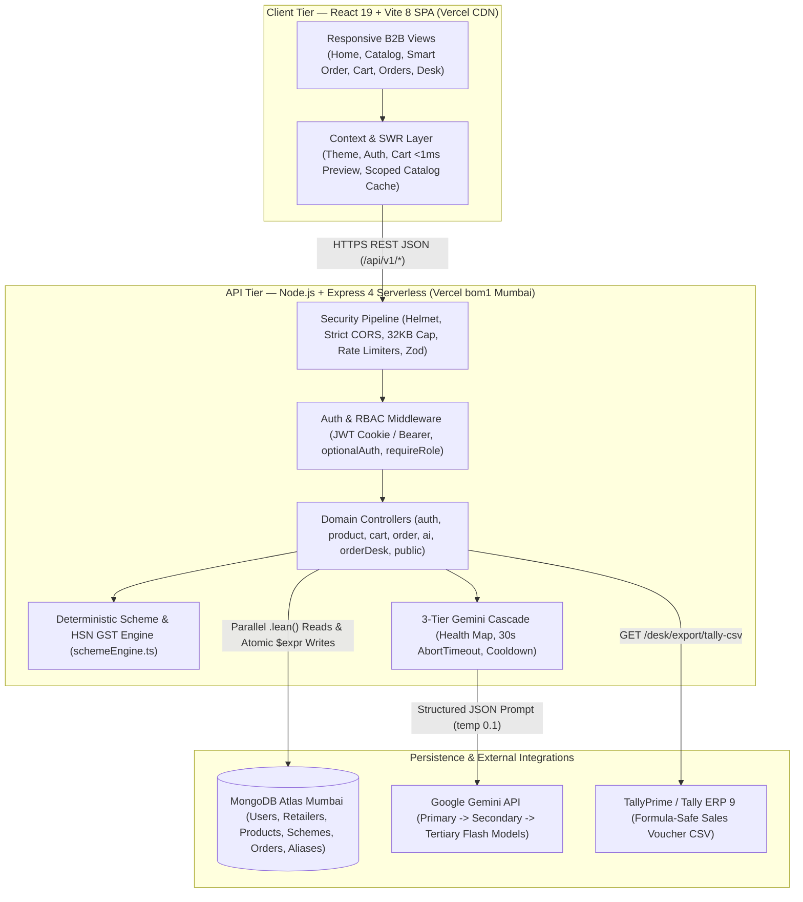
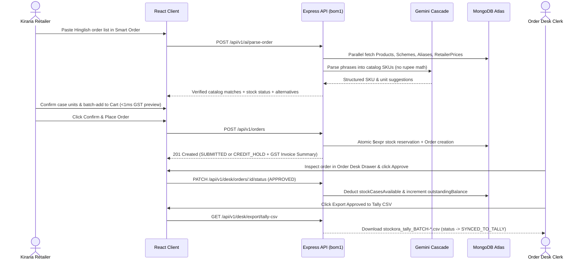

<a id="readme-top"></a>

<div align="center">

# 📦 Stockora

### Wholesale FMCG Ordering, Deterministic Scheme Engine & Tally ERP Bridge

*Orders made simple — turning informal kirana shop lists into stock-verified, GST-accurate wholesale dispatches in under a minute.*

Stockora is a full-stack B2B wholesale ordering and distributor operations platform engineered for high-volume FMCG distribution in Jabalpur, Madhya Pradesh. It connects kirana shopkeepers and distributor Order Desk teams with real-time carton stock, shop-specific wholesale rates, AI-assisted Hinglish order capture, deterministic trade scheme & HSN GST calculation, automated credit-limit holds, and 1-click Tally ERP CSV export.

[](https://react.dev/)
[](https://www.typescriptlang.org/)
[](https://vite.dev/)
[](https://tailwindcss.com/)
[](https://nodejs.org/)
[](https://expressjs.com/)
[](https://www.mongodb.com/atlas)
[](https://ai.google.dev/)
[-000000?style=for-the-badge&logo=vercel&logoColor=white)](https://stockora-khaki.vercel.app)

<br />

[**🌐 Live Application**](https://stockora-khaki.vercel.app) · [**🩺 Live API Health**](https://stockora-server-app.vercel.app/api/v1/health) · [**💻 GitHub Repository**](https://github.com/KandatiRanjithKumarReddy/Stockora)

</div>

---

<a id="table-of-contents"></a>
## 📑 Table of Contents

1. [Core Concept](#core-concept)
2. [Key Questions & Project Objectives](#key-questions--project-objectives)
3. [Key Features](#key-features)
4. [Feature Deep Dives](#feature-deep-dives)
5. [System Architecture](#system-architecture)
6. [Tech Stack](#tech-stack)
7. [Test Scenarios & Sample Personas](#test-scenarios--sample-personas)
8. [Core Implementation & Business Logic](#core-implementation--business-logic)
9. [Security & Privacy](#security--privacy)
10. [Installation & Setup](#installation--setup)
11. [API Documentation](#api-documentation)
12. [Future Improvements](#future-improvements)
13. [License & Credits](#license--credits)

---

<a id="core-concept"></a>
## 🎯 Core Concept

### The Problem

Regional FMCG wholesale distributors serving 1,800+ neighborhood *kirana* stores handle hundreds of multi-line carton orders every day across fragmented, manual channels:

- **Unstructured Order Intake:** Shopkeepers send informal Hinglish WhatsApp messages (*"bhaiya 5 peti biscuit chhota, 2 peti washing powder 1 kilo, chai patti 250 wala 1 peti"*) or notebook lists between walk-in customers.
- **Zero Counter Visibility:** Retailers cannot see live warehouse carton availability, their negotiated shop-specific pack rate, active trade schemes (*Buy 10 Get 1 Free*, volume slab discounts), or GST exclusivity while ordering.
- **Costly Manual Re-Entry & Errors:** Office clerks manually re-type every order into Tally ERP the next morning. Ambiguous pack sizes or unit assumptions (*case* vs. *piece*) trigger wrong dispatches, return pickups, stock-out cancellations discovered after ordering, and delayed billing.

### The Solution

**Stockora** unifies kirana self-ordering, AI-assisted message capture, warehouse stock control, and accounting export into one fast, mobile-first web platform:

- **Sub-Second Wholesale Catalog:** Built for budget Android phones and slow 3G connections using `< 2 KB` local vector SKU illustrations, code-split bundles, and Mumbai (`bom1`) serverless compute co-located with MongoDB Atlas.
- **Human-Verified Smart Order Capture:** Parses informal Hindi/Hinglish text notes against the live SKU catalog and retailer-specific alias memory—requiring explicit human confirmation on ambiguous units and never placing an unverified order.
- **100% Deterministic Financial Engine:** Strictly separates AI language parsing from rupee math. Every pack-to-case rate, promotional free case, percentage slab discount, HSN `CGST`/`SGST` split, and credit-limit check is computed deterministically in TypeScript.
- **Order Desk Triage & 1-Click Tally Bridge:** Flags credit-overrun orders into `CREDIT_HOLD`, lets distributor staff inspect, edit, approve, or reject stock reservations, and exports approved vouchers directly into a TallyPrime / Tally ERP 9 CSV batch.

---

<a id="key-questions--project-objectives"></a>
## 🧭 Key Questions & Project Objectives

| # | Question / Objective | What the Application Provides | How It Works |
| :--- | :--- | :--- | :--- |
| **1** | **How can shopkeepers order in under a minute on slow 3G phones?** | Lightweight mobile catalog with large touch targets (`>= 44px`), instant search, and zero heavy product photography. | Uses `< 2 KB` local SVG carton illustrations, route-level `React.lazy` code splitting (`~19.8 kB` gzipped app entry), user-scoped SWR memory caching, and Mumbai (`bom1`) API execution. |
| **2** | **How do we convert messy Hinglish WhatsApp notes without wrong SKU dispatches?** | **Stockora Smart Order** drafts structured carton lines with confidence scores, alternative SKUs, and unit checks. | Runs a 3-tier Gemini model cascade enriched with `RetailerAlias` history, verifies returned SKUs against active MongoDB products, flags unclear *case vs. piece* units, and blocks cart addition until confirmed. |
| **3** | **How do we ensure 100% accurate trade schemes and GST math?** | Itemized wholesale billing with free-goods schemes, slab discounts, and explicit GST disclosures (`Excl. GST`). | `schemeEngine.ts` computes exact case prices, `BUY_X_GET_Y_FREE` multipliers, `SLAB_PERCENT_DISCOUNT` deductions, and per-HSN `CGST + SGST` splits—never delegating arithmetic to AI. |
| **4** | **How are shop-specific negotiated prices and credit balances kept confidential?** | Public visitors see catalog items and MRPs only; wholesale rates and credit exposure are restricted to authorized roles. | `optionalAuth` redacts `dealerPricePerPack`, `calculatedCasePrice`, and `availableCases` when unauthenticated, enforces `Cache-Control: private, no-store`, and isolates custom `RetailerPrice` overrides per shop. |
| **5** | **How do we stop warehouse overselling and credit over-exposure?** | Real-time carton stock reservation on submission plus automatic **Credit Hold** routing when exposure exceeds limits. | `POST /api/v1/orders` executes atomic `$expr` MongoDB stock reservations with automatic rollback on contention and compares `outstandingBalance + finalPayableAmount` against `creditLimit`. |
| **6** | **How does the office desk eliminate manual Tally ERP data entry?** | **Order Desk Command Center** with status queues, line-item editing, audit trails, and 1-click Tally CSV export. | Staff triage `SUBMITTED` and `CREDIT_HOLD` orders, permanently deduct stock on `APPROVED`, and download formula-sanitized sales vouchers transitioning orders to `SYNCED_TO_TALLY`. |

---

<a id="key-features"></a>
## ✨ Key Features

- 📦 **Mobile-First Wholesale Catalog:** Instant SKU/keyword debounced search, category pills, brand selector, and *In-Stock Only* filter with explicit per-pack dealer rate, full-case rate, HSN code, and `Excl. X% GST` transparency.
- 🤖 **Stockora Smart Order (Hinglish Capture):** Translates mixed Hindi, Hinglish, and English order text into structured catalog lines with confidence badges, one-tap alternative SKU swaps, mandatory unit confirmation, and persistent retailer alias learning.
- 🧮 **Deterministic Trade Scheme & Tax Engine:** Automatically applies **Buy X Get Y Free** carton promotions and **Volume Slab Percentage Discounts**, paired with `< 1 ms` client-side checkout previews synchronized with server-authoritative calculations.
- 🔒 **Retailer-Specific Price Overrides & Privacy:** Supports negotiated per-shop pack rates (`RetailerPrice` validity windows) badged as `Shop Rate` while strictly hiding wholesale rates and stock counts from unauthenticated visitors.
- 🏭 **Dual-Pool Atomic Stock Reservation:** Separates physical inventory (`stockCasesAvailable`) from pending commitments (`stockCasesReserved`) so concurrent checkouts never oversell warehouse stock.
- 🛡️ **Automated Credit-Limit Hold Policy:** Evaluates real-time credit exposure at checkout—preserving valid orders under `CREDIT_HOLD` for Order Desk review instead of rejecting high-value kirana demand.
- 🖥️ **Order Desk Operations Workspace:** High-density staff portal with live queue KPIs, slide-over order inspection drawer, raw Smart Order transcript viewer, line-quantity recalculation, and `staffCorrections` audit logging.
- 📄 **1-Click Tally ERP CSV Export:** Generates standardized TallyPrime / Tally ERP 9 sales voucher batches (`VoucherDate`, `PartyName`, `SKU`, `BilledQty`, `FreeQty`, `Rate`, `DiscountPercent`, `Amount`) with batch tracking.
- ☀️ **Light-Default Commercial UI & True-Black Dark Mode:** Crisp Light Theme by default (`#FAFAFA` / `#FFFFFF` surfaces with `tabular-nums` financial alignment) plus optional manual switching to a zero-glare `#000000` True-Black Dark Theme.

---

<a id="feature-deep-dives"></a>
## 🔍 Feature Deep Dives

### 1. Mobile-First Wholesale Catalog & Shop Pricing
- **Overview:** Designed for shopkeepers ordering rapidly between walk-in retail customers, presenting carton economics clearly without visual clutter.
- **User Workflow:** Browse products publicly by category or brand -> Sign in via mobile password, 6-digit OTP, or 1-Click Demo -> View unlocked shop-specific case rates, live carton counts, and active scheme banners -> Adjust case steppers and add to cart.
- **Technical Implementation:** `CatalogPage.tsx` uses a `250 ms` debounced search input with `AbortController` cancellation and a user-partitioned in-memory cache (`ownerKey::category::brand::search::inStock`) for `0 ms` tab switches. On the backend, `productController.ts` executes `Product`, `Scheme`, and `RetailerPrice` `.lean()` queries in parallel via `Promise.all`.
- **Example:** When *M/s Gupta Kirana Bhandar* logs in, `SKU-BS-120` (*Glucose Biscuit Family Pack 120g*) automatically overrides the standard `₹16.50/pack` (`₹990.00/case`) rate with their negotiated **Shop Rate** of `₹15.90/pack` (`₹954.00/case`).

### 2. Stockora Smart Order (AI Order Capture & Alias Memory)
- **Overview:** Converts unstructured WhatsApp/Hinglish text notes into verified carton line items while keeping humans in control of every unit and SKU decision.
- **User Workflow:** Open **Smart Order** -> Paste a raw order message -> Click **Match Catalog Items** -> Review matched products, original words, confidence levels, stock notices (e.g., out-of-stock lines automatically excluded from checkout), and alternative SKUs -> Confirm any ambiguous units as `Cases` -> Add all confirmed items to cart in a single batch.
- **Technical Implementation:** `aiController.ts` lazy-loads `geminiCascadeService.ts` and injects both active catalog SKUs and the shop's `RetailerAlias` records into a structured JSON prompt (`temperature: 0.1`). Every AI suggestion is cross-checked against active MongoDB `Product` documents so hallucinated SKUs are impossible. Confirmed alias mappings are persisted via `POST /api/v1/ai/alias`.
- **Example:** Inputting `"bhaiya 5 peti biscuit chhota, 2 peti washing powder 1 kilo, chai patti 250 wala 1 peti"` maps `biscuit chhota` -> `SKU-BS-075` (`5` cases, in stock), `washing powder 1 kilo` -> `SKU-DT-1KG` (`2` cases, in stock), and `chai patti 250` -> `SKU-TE-250` (flagged `Out of Stock` with `0` cases available).

### 3. Deterministic Checkout, GST Breakdown & Credit Hold
- **Overview:** Provides instant financial clarity as retailers adjust carton quantities, followed by atomic stock locking and credit-limit verification upon order submission.
- **User Workflow:** Adjust carton counts in `CartPage.tsx` -> Instantly view updated Base Subtotal, Trade Scheme Savings, `CGST`, `SGST (MP)`, Net Payable, and Projected Credit Balance -> Submit order -> Immediately view the **Confirmed Invoice & Final Payable** summary with voucher reference (`STK-YYYYMMDD-XXXX`).
- **Technical Implementation:** `CartContext.tsx` runs an instant `< 1 ms` deterministic preview mirroring `schemeEngine.ts` while syncing live stock warnings via a `180 ms` debounced `POST /api/v1/cart/calculate` request. Submitting via `POST /api/v1/orders` executes three parallelized database waves and snapshots all rates, HSN codes, schemes, and credit metrics onto the immutable `Order` document.

### 4. Order Desk Command Center & Tally ERP Export
- **Overview:** Gives distributor office staff a unified queue to review incoming orders, resolve credit holds, edit line quantities, and export accounting vouchers.
- **User Workflow:** Sign in via **Order Desk Portal** -> Filter queue by `All`, `Submitted`, `Credit Hold`, `Approved`, or `Synced to Tally` -> Open the slide-over inspection drawer to audit credit exposure, Smart Order raw text, and itemized lines -> Approve (or edit/reject) -> Click **Export Approved to Tally CSV**.
- **Technical Implementation:** `orderDeskController.ts` uses optimistic concurrency (`Order.findOneAndUpdate({ _id, status: prevStatus })`) to prevent double-approval race conditions, adjusts `stockCasesAvailable`, `stockCasesReserved`, and `Retailer.outstandingBalance`, records `staffCorrections`, and streams RFC-compliant CSV batches (`stockora_tally_BATCH-<timestamp>.csv`).

---

<a id="system-architecture"></a>
## 🏗️ System Architecture

Stockora follows a decoupled **Client–Server–Database** architecture deployed across Vercel's Edge CDN (`client/`) and Mumbai `bom1` Serverless Functions (`server/`), co-located with **MongoDB Atlas** (`ap-south-1` Mumbai) for low-latency database roundtrips.

### High-Level Architecture Diagram



### End-to-End Order & Triage Sequence



---

<a id="tech-stack"></a>
## 🛠️ Tech Stack

| Tier | Technology | Purpose |
| :--- | :--- | :--- |
| **Frontend Framework** | `React 19.3` + `TypeScript` | Component architecture, hash-based workspace routing, `React.lazy` code splitting, and context state management |
| **Build & Bundler** | `Vite 8.3` | Fast HMR dev server and Rollup/Rolldown vendor chunk splitting (`vendor-react`, `vendor-http`, `vendor-icons`) |
| **Styling & Icons** | `Tailwind CSS 3.4` + `Lucide React` | Light-default B2B design tokens, `#000000` True-Black dark mode (`darkMode: 'class'`), and crisp UI iconography |
| **HTTP Client** | `Axios 1.21` | REST API client with automatic JWT request interceptors, `withCredentials` cookie support, and `AbortController` cancellation |
| **Backend Runtime** | `Node.js (ESM)` + `Express 4.21` + `TypeScript 5.7` | Stateless REST API server compatible with both standalone Node (`tsx`) and Vercel Serverless Functions |
| **Database & ODM** | `MongoDB Atlas` + `Mongoose 8.10` | Document persistence, compound indexing, `.lean()` read pipelines, and atomic `$expr` inventory updates |
| **Validation & Security** | `Zod 3.24`, `Helmet 8.3`, `express-rate-limit 8.7`, `cors` | Strict request payload validation, HTTP security headers, tiered IP rate limiting, and origin allowlisting |
| **Authentication** | `jsonwebtoken 9.0` + `bcryptjs 3.0` + `cookie-parser` | Stateless 7-day JWT sessions via `HttpOnly` cookies / `Bearer` headers and salted password hashing |
| **AI Integration** | `@google/generative-ai 0.24` | Lazy-loaded 3-model Google Gemini cascade (`gemini-3.5-flash-lite` -> `gemini-3.5-flash` -> `gemini-3.1-flash-lite`) |
| **ERP Integration** | Custom RFC-4180 CSV Serializer | Formula-sanitized wholesale sales voucher export for TallyPrime and Tally ERP 9 |
| **Cloud Hosting** | `Vercel` (`bom1` Mumbai + Global Edge CDN) | Separate production deployments for SPA client and Mumbai-pinned backend API |

---

<a id="test-scenarios--sample-personas"></a>
## 🧪 Test Scenarios & Sample Personas

Running `npm run seed` populates realistic Jabalpur wholesale data—including **5 FMCG SKUs** (`SKU-BS-075`, `SKU-DT-1KG`, `SKU-TE-250`, `SKU-BS-120`, `SKU-ND-070`), **2 active trade schemes**, **custom shop pricing**, **Hinglish retailer aliases**, and **4 role-based accounts** (local demo credentials are printed to your terminal upon seeding, or accessible via the UI's **1-Click Demo Account** and **Demo OTP** flows).

| Persona / Store | Role | Registered Mobile / Sign-In Mode | Credit Profile | Primary Test Scenario |
| :--- | :--- | :--- | :--- | :--- |
| **Ramesh Gupta** — *M/s Gupta Kirana Bhandar* (Wright Town, Jabalpur) | `RETAILER` | `9826012345` *(Password, Demo OTP, or 1-Click Demo)* | Limit: `₹60,000` · Balance: `₹12,400` (`GOOD`) | Standard catalog ordering, negotiated **Shop Rate** (`₹15.90/pack` on `SKU-BS-120`), Smart Order Hinglish parsing with pre-seeded aliases, and normal `SUBMITTED` checkout. |
| **Sunil Verma** — *Verma Super Daily Needs* (Gorakhpur, Jabalpur) | `RETAILER` | `9826054321` *(Password or Demo OTP)* | Limit: `₹40,000` · Balance: `₹38,500` (`WATCH`) | **Credit Hold Policy:** Any order above `₹1,500` pushes projected exposure past `₹40,000`, automatically routing the voucher into `CREDIT_HOLD` for Order Desk review. |
| **New Kirana Onboarding** — *Self-Registration Flow* | `RETAILER` | *New Shop Onboarding* tab (any unused 10-digit Indian mobile) | Default Limit: `₹50,000` (`₹25,000` via OTP auto-provision) | Tests parallelized `Retailer` + `User` account creation and immediate authenticated catalog access. |
| **Pooja Sharma** — *Distributor Office Clerk* | `ORDER_DESK` | `9425099881` *(Order Desk Portal — Password only; OTP blocked)* | Staff Operations Role | Inspect `SUBMITTED` and `CREDIT_HOLD` queues, edit order case quantities, approve/reject dispatches, and download Tally ERP CSV batches. |
| **Rajesh Agarwal** — *Distributor Principal* | `ADMIN` | `9425000001` *(Order Desk Portal — Password only; OTP blocked)* | Full Administrative Role | Executive oversight across all Order Desk queues, credit overrides, and Tally batch exports. |

---

<a id="core-implementation--business-logic"></a>
## ⚙️ Core Implementation & Business Logic

### 1. Deterministic Scheme & HSN Tax Engine (`server/src/services/schemeEngine.ts`)

Financial integrity is enforced through a strict architectural rule: **AI never computes prices, discounts, or taxes.** Both `POST /api/v1/cart/calculate` and `POST /api/v1/orders` pass verified database snapshots through `calculateOrderFinancials()`:

1. **Pack-to-Case Derivation:** Uses `customDealerPricePerPack` if a valid `RetailerPrice` override exists, otherwise `product.dealerPricePerPack`:
   ```text
   casePrice   = round2(packPrice × unitsPerCase)
   grossAmount = round2(casePrice × orderedCases)
   ```
2. **Trade Scheme Application:**
   - `BUY_X_GET_Y_FREE`: `freeCases = floor(orderedCases / buyQuantity) × freeQuantity` (adds promotional free cartons at `₹0` extra cost).
   - `SLAB_PERCENT_DISCOUNT`: When `orderedCases >= minSlabQuantity`, `discountAmount = round2(grossAmount × (discountPercentage / 100))`.
3. **GST-Exclusive HSN Taxation (Intra-State MP Supply):**
   ```text
   taxableAmount = round2(grossAmount - discountAmount)
   cgstAmount    = round2(taxableAmount × (gstRatePercent / 200))
   sgstAmount    = round2(taxableAmount × (gstRatePercent / 200))
   netAmount     = round2(taxableAmount + cgstAmount + sgstAmount)
   ```
4. **Invoice Rounding:** Aggregates all lines and rounds `finalPayableAmount = Math.round(subtotal - totalDiscount + totalTax)` to the nearest rupee, mirrored identically on the client (`computeClientCartPreview` in `CartContext.tsx`) with `₹0.00` variance.

#### Worked Calculation Example (`10` Cases `SKU-BS-075` + `5` Cases `SKU-DT-1KG`)

| SKU | Cases | Case Rate (`₹`) | Gross (`₹`) | Active Scheme Applied | Taxable (`₹`) | GST Rate | `CGST + SGST` (`₹`) | Line Net (`₹`) |
| :--- | :---: | :---: | :---: | :--- | :---: | :---: | :---: | :---: |
| `SKU-BS-075` | `10` | `777.60` | `7,776.00` | **+1 Free Case** (*10+1 Bonanza*) | `7,776.00` | `5%` | `194.40 + 194.40` | `8,164.80` |
| `SKU-DT-1KG` | `5` | `2,030.00` | `10,150.00` | **-3% Slab** (`-₹304.50`) | `9,845.50` | `18%` | `886.09 + 886.09` | `11,617.68` |
| **Invoice Total** | **15 (+1 Free)** | — | **`17,926.00`** | **`-₹304.50` + `1` Free Case** | **`17,621.50`** | — | **`2,160.98`** | **`₹19,782`** |

*\*Rounded to nearest rupee: `Math.round(17,926.00 - 304.50 + 2,160.98) = Math.round(19,782.48) = ₹19,782`.*

---

### 2. Resilient 3-Tier AI Cascade (`server/src/services/ai/geminiCascadeService.ts`)

- **Lazy SDK Initialization:** `@google/generative-ai` is dynamically imported only inside `parseWhatsAppOrder`, keeping authentication, catalog, and checkout cold starts lightweight.
- **Priority Model Cascade & Circuit Breaker:** Attempts `GEMINI_PRIMARY_MODEL` -> `GEMINI_SECONDARY_MODEL` -> `GEMINI_TERTIARY_MODEL` with per-attempt `AbortController` timeouts (`30s` default). Consecutive transient `429`/`503`/timeout errors place degraded models into a timed cooldown (`AI_MODEL_COOLDOWN_MS`) with automatic half-open probe recovery, while fatal `401`/`403` credential errors short-circuit immediately.
- **Internal-Only Telemetry:** Model selection, fallback flags, latency, and attempt errors are logged internally to `AIProcessingLog` and never leaked to client responses.

---

### 3. Atomic Stock Reservation & Order Lifecycle (`orderController.ts` & `orderDeskController.ts`)

Every `Product` tracks `stockCasesAvailable` and `stockCasesReserved`. During `POST /api/v1/orders`, Stockora reserves stock across all order lines in parallel using an atomic MongoDB `$expr` guard:

```typescript
Product.findOneAndUpdate(
  {
    _id: item.productId,
    isActive: true,
    $expr: {
      $gte: [{ $subtract: ['$stockCasesAvailable', '$stockCasesReserved'] }, item.orderedCases],
    },
  },
  { $inc: { stockCasesReserved: item.orderedCases } },
  { new: true }
);
```

- **Contention Rollback:** If any line fails reservation due to concurrent checkout, all succeeded reservations in the batch are immediately rolled back in parallel (`$inc: { stockCasesReserved: -orderedCases }`).
- **State Machine:**
  - `SUBMITTED` / `CREDIT_HOLD` / `UNDER_REVIEW` -> **`APPROVED`**: Permanently decrements both `stockCasesAvailable` and `stockCasesReserved`, and increments `Retailer.outstandingBalance`.
  - `SUBMITTED` / `CREDIT_HOLD` / `UNDER_REVIEW` -> **`REJECTED`**: Releases `stockCasesReserved` back into the sellable pool without touching physical stock.
  - `APPROVED` -> **`SYNCED_TO_TALLY`**: Recorded atomically with `exportBatchId` and `exportedAt` upon CSV generation.

---

### 4. MongoDB Data Models (`server/src/models/`)

| Model | Key Fields & Indexes | Role in System |
| :--- | :--- | :--- |
| `User` | `phone` (unique), `role` (`RETAILER`, `ORDER_DESK`, `ADMIN`), `status`, `retailerId` | Authentication identity, status gating, and RBAC boundary |
| `Retailer` | `storeName`, `phone`, `gstin`, `creditLimit`, `outstandingBalance`, `creditStatus` | Kirana shop profile, GSTIN details, and live credit exposure ledger |
| `Product` | `sku` (unique), `hsnCode`, `unitsPerCase`, `dealerPricePerPack`, `gstRatePercent`, `stockCasesAvailable`, `stockCasesReserved` | Wholesale SKU master, carton pack conversion, HSN tax rate, and dual-pool inventory |
| `Scheme` | `primaryProductId`, `schemeType`, `buyQuantity`, `freeQuantity`, `minSlabQuantity`, `discountPercentage`, `startDate`, `endDate` | Time-bounded promotional free-goods and slab discount rules |
| `RetailerPrice` | `{ retailerId, productId }` (unique compound), `customDealerPricePerPack`, `validFrom`, `validTo` | Shop-specific negotiated wholesale pack rates |
| `RetailerAlias` | `{ retailerId, rawKeyword }` (unique compound), `mappedSku`, `preferredUnit`, `createdFrom` | Per-shop Hinglish/shorthand vocabulary learned from confirmations and desk edits |
| `Order` | `orderNumber` (unique `STK-YYYYMMDD-XXXX`), `status`, `items[]`, `creditCheck`, `tallyExport`, `staffCorrections[]` | Immutable financial snapshot, credit-hold audit, staff correction log, and Tally sync state |
| `AIProcessingLog` | `retailerId`, `selectedModel`, `attemptedModels[]`, `fallbackTriggered`, `durationMs`, `status` | Internal operational observability for Smart Order cascade health |
| `Contact` / `Feedback` | `fullName`, `email`, `subject`, `category`, `message`, `role` | Public distributor inquiries and in-app product feedback submissions |

---

<a id="security--privacy"></a>
## 🔐 Security & Privacy

- **Strict Wholesale Price & Credit Privacy:**
  - Unauthenticated calls to `GET /api/v1/products` strip `dealerPricePerPack`, `calculatedCasePrice`, `availableCases`, and `hasCustomPrice`, returning `priceRestricted: true` and `Cache-Control: private, no-store` so CDN proxies never cache one shop's rates for another.
  - On the client, `CatalogPage` partitions memory caches by `user.id`, and `CartContext` automatically purges `localStorage` cart state upon sign-out or account switch on shared devices.
- **Role-Based Access Control & OTP Hardening:**
  - Passwordless OTP (`POST /api/v1/auth/otp/*`) strictly blocks `ORDER_DESK` and `ADMIN` accounts (`403 Forbidden`), ensuring distributor staff must always authenticate with salted `bcryptjs` passwords.
  - Every `/api/v1/desk/*` endpoint is gated behind `requireAuth` + `requireRole('ORDER_DESK', 'ADMIN')`.
  - Tenant checks in `orderController.ts` and `aiController.ts` ensure a `RETAILER` can only view their own orders and modify aliases belonging to their own `retailerId`.
- **Transport, Payload & Rate-Limit Hardening (`server/src/app.ts`):**
  - **HTTP Headers:** `helmet` middleware enabled across all routes.
  - **CORS Allowlisting:** Normalizes trailing slashes, restricts cross-origin credentials to `CLIENT_ORIGIN` and verified Vercel deployment URLs, and caches preflights for 24 hours (`maxAge: 86400`).
  - **Payload Caps:** `express.json({ limit: '32kb' })` and `express.urlencoded({ limit: '32kb' })` mitigate oversized payload memory exhaustion.
  - **Tiered Rate Limiting:** General API (`400 req / 15 min`), Auth endpoints (`25 req / 15 min`), Smart Order AI (`25 req / 10 min`), and Public forms (`15 req / 15 min`).
- **Injection & CSV Formula Protection:**
  - All write payloads are validated and length-bounded with **Zod** schemas.
  - User search strings are sanitized through `escapeRegex()` before MongoDB `$regex` construction to prevent ReDoS crashes.
  - Tally CSV exports sanitize all text fields through `sanitizeCsvCell()`, neutralizing spreadsheet formula execution prefixes (`=`, `+`, `-`, `@`, `\t`, `\r`).

---

<a id="installation--setup"></a>
## 🚀 Installation & Setup

### Prerequisites

- **Node.js** `v20.x` or newer (`v22.x` recommended) and **npm**
- **MongoDB Atlas** cluster URI (or local MongoDB `7.0+` instance)
- **Google Gemini API Key** *(optional — required only for live Smart Order AI parsing)*

### 1. Clone the Repository

```bash
git clone https://github.com/KandatiRanjithKumarReddy/Stockora.git
cd Stockora
```

### 2. Install Dependencies

Install workspace root helpers along with `server` and `client` packages:

```bash
npm install
cd server && npm install
cd ../client && npm install
cd ..
```

### 3. Configure Environment Variables

Create `server/.env`:

```env
PORT=5000
NODE_ENV=development
ENABLE_DEMO_AUTH=true
MONGODB_URI=mongodb+srv://<username>:<password>@<cluster>.mongodb.net/stockora?retryWrites=true&w=majority
JWT_SECRET=replace_with_a_strong_random_secret_at_least_24_chars
JWT_EXPIRES_IN=7d

# Smart Order Gemini Cascade (Optional for catalog/checkout)
GEMINI_API_KEY=your_google_gemini_api_key
GEMINI_PRIMARY_MODEL=gemini-3.5-flash-lite
GEMINI_SECONDARY_MODEL=gemini-3.5-flash
GEMINI_TERTIARY_MODEL=gemini-3.1-flash-lite
AI_PRIMARY_TIMEOUT_MS=30000
AI_FALLBACK_TIMEOUT_MS=30000
AI_MODEL_COOLDOWN_MS=30000

STOCK_RESERVATION_EXPIRY_MINUTES=1440
CLIENT_ORIGIN=http://localhost:5173
```

Create `client/.env`:

```env
VITE_API_URL=http://localhost:5000/api/v1
```

### 4. Seed Sample Wholesale Data & Run Locally

```bash
# Seed Jabalpur retailers, 5 FMCG SKUs, trade schemes, shop price overrides, and aliases
npm run seed

# Terminal 1 — Start Express API Server (http://localhost:5000)
npm run dev:server

# Terminal 2 — Start React + Vite Client (http://localhost:5173)
npm run dev:client
```

### 5. Production Build & Deployment

```bash
# Type-check and build both server (dist/) and client (dist/) workspaces
npm run build
```

- **Backend (`server/`):** Includes `server/vercel.json` pinned to `"regions": ["bom1"]` (Mumbai, India) with `maxDuration: 60` and default Express app export in `src/app.ts`. Set `CLIENT_ORIGIN` to your deployed frontend origin.
- **Frontend (`client/`):** Includes `client/vercel.json` SPA rewrites. Set `VITE_API_URL` to `https://<your-backend-domain>/api/v1`.

---

<a id="api-documentation"></a>
## 📡 API Documentation

All endpoints are mounted under `/api/v1` (plus root health checks). Protected routes accept either an `Authorization: Bearer <token>` header or an `HttpOnly` `token` session cookie.

| Method | Endpoint | Description | Authentication |
| :--- | :--- | :--- | :--- |
| `GET` | `/api/v1/health` | Service health status, version, and ISO timestamp | Public |
| `POST` | `/api/v1/auth/register` | Onboard a new kirana store (`Retailer` + `User`) and issue session JWT | Public *(Rate-limited)* |
| `POST` | `/api/v1/auth/login` | Sign in with 10-digit mobile number and password across Retailer, Desk, or Admin | Public *(Rate-limited)* |
| `POST` | `/api/v1/auth/otp/request` | Request demo 6-digit SMS OTP for `RETAILER` accounts (blocks staff roles) | Public *(Demo Auth)* |
| `POST` | `/api/v1/auth/otp/verify` | Verify 6-digit OTP and sign in or auto-provision kirana retailer session | Public *(Demo Auth)* |
| `POST` | `/api/v1/auth/google` | Authenticate demo retailer account in 1 click | Public *(Demo Auth)* |
| `GET` | `/api/v1/auth/me` | Fetch current authenticated user profile and linked `Retailer` credit/shop record | `requireAuth` |
| `POST` | `/api/v1/auth/logout` | Clear `HttpOnly` session cookie | Public |
| `GET` | `/api/v1/products` | List active catalog SKUs with filters (`category`, `brand`, `search`, `inStock`); unlocks shop rates when signed in | `optionalAuth` |
| `GET` | `/api/v1/products/categories` | Fetch sorted distinct active product categories and brands | Public |
| `GET` | `/api/v1/products/:id` | Fetch single product detail with active trade scheme and shop-specific rate | `optionalAuth` |
| `POST` | `/api/v1/cart/calculate` | Deterministically compute carton subtotals, free cases, slab discounts, `CGST`/`SGST`, and stock warnings | `requireAuth` |
| `POST` | `/api/v1/orders` | Atomically reserve carton stock, evaluate credit hold, and create an immutable `Order` | `requireAuth` (`RETAILER`) |
| `GET` | `/api/v1/orders/my` | List the signed-in retailer's historical orders sorted newest-first | `requireAuth` (`RETAILER`) |
| `GET` | `/api/v1/orders/:id` | Retrieve single order detail (enforces owner isolation for retailers) | `requireAuth` |
| `POST` | `/api/v1/ai/parse-order` | Parse Hindi/Hinglish order text into verified catalog SKU suggestions | `requireAuth` *(Rate-limited)* |
| `POST` | `/api/v1/ai/alias` | Save or update a retailer-specific keyword -> SKU alias mapping | `requireAuth` *(Tenant-checked)* |
| `GET` | `/api/v1/desk/orders` | Paginated Order Desk queue with status filter, shop/order search, and live status counts | `ORDER_DESK` / `ADMIN` |
| `GET` | `/api/v1/desk/orders/:id` | Detailed order and retailer credit inspection for Order Desk drawer | `ORDER_DESK` / `ADMIN` |
| `PATCH` | `/api/v1/desk/orders/:id/status` | Transition order status (`APPROVED`, `REJECTED`, `CREDIT_HOLD`, `UNDER_REVIEW`) and reconcile stock/credit | `ORDER_DESK` / `ADMIN` |
| `PUT` | `/api/v1/desk/orders/:id/lines` | Edit order carton quantities, adjust stock reservations, and recalculate GST/schemes | `ORDER_DESK` / `ADMIN` |
| `GET` | `/api/v1/desk/export/tally-csv` | Export `APPROVED` orders as a Tally ERP CSV file and mark `SYNCED_TO_TALLY` | `ORDER_DESK` / `ADMIN` |
| `POST` | `/api/v1/public/contact` | Submit distributor support / trade inquiry form | Public *(Rate-limited)* |
| `POST` | `/api/v1/public/feedback` | Submit categorized product or AI accuracy feedback | Public *(Rate-limited)* |

---

<a id="future-improvements"></a>
## 🗺️ Future Improvements

The following capabilities represent planned roadmap extensions beyond the current production build:

- **Offline-First Salesman Beat Mode:** Service Worker IndexedDB queue enabling field salesmen to capture counter orders inside zero-signal markets and auto-sync upon reconnection.
- **Multimodal Smart Order Capture:** Extending `POST /api/v1/ai/parse-order` to accept photos of handwritten Hindi shop lists and WhatsApp voice notes alongside text messages.
- **Van Loading & Beat Aggregation Sheets:** Generating consolidated warehouse pick-lists grouped by Jabalpur delivery locality and carton weight (`caseWeightKg`).
- **14-Day Dormant Kirana Retention View:** Dedicated Order Desk widget highlighting active retailers with no orders in the past 14 days for proactive salesman follow-up.
- **Automated Reservation Expiry Sweeper:** Scheduled background job to automatically release `stockCasesReserved` on unreviewed holds past `reservationExpiresAt`.

---

<a id="license--credits"></a>
## 📄 License & Credits

<div align="center">

Developed by **Kandati Ranjith Kumar Reddy** ([`@KandatiRanjithKumarReddy`](https://github.com/KandatiRanjithKumarReddy)) · **Stockora Engineering**

Built for wholesale FMCG distribution workflows in Jabalpur, Madhya Pradesh.  
All source code is available in the [Stockora GitHub Repository](https://github.com/KandatiRanjithKumarReddy/Stockora).

Copyright © 2026 Stockora. All rights reserved.

<br />

[**⬆️ Back to Top**](#readme-top)

</div>
